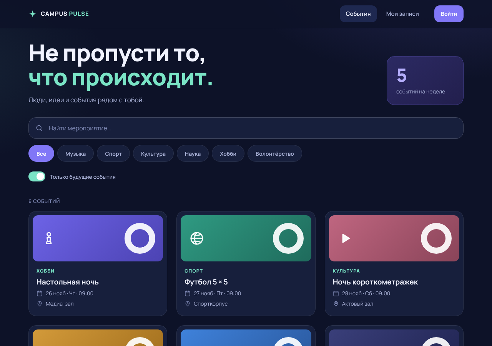
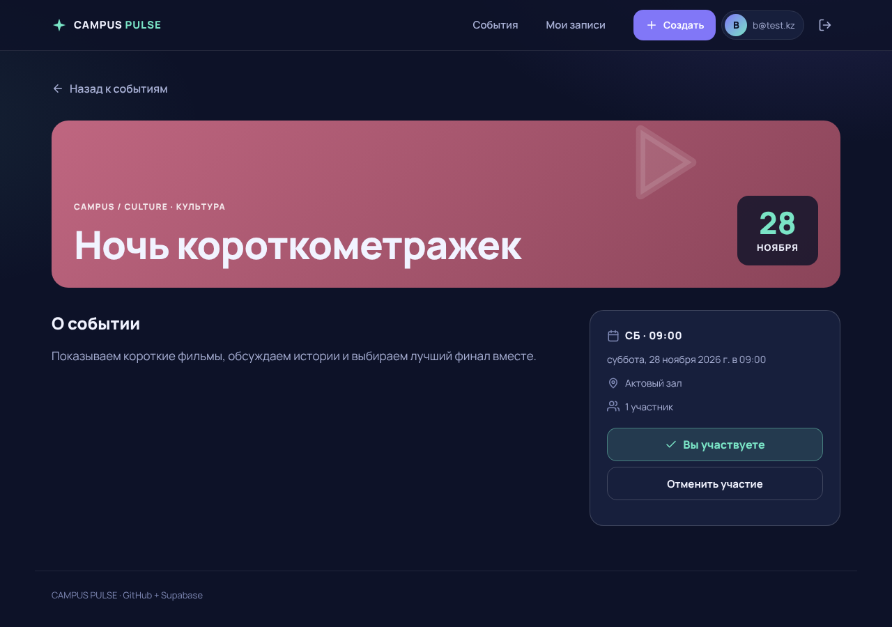
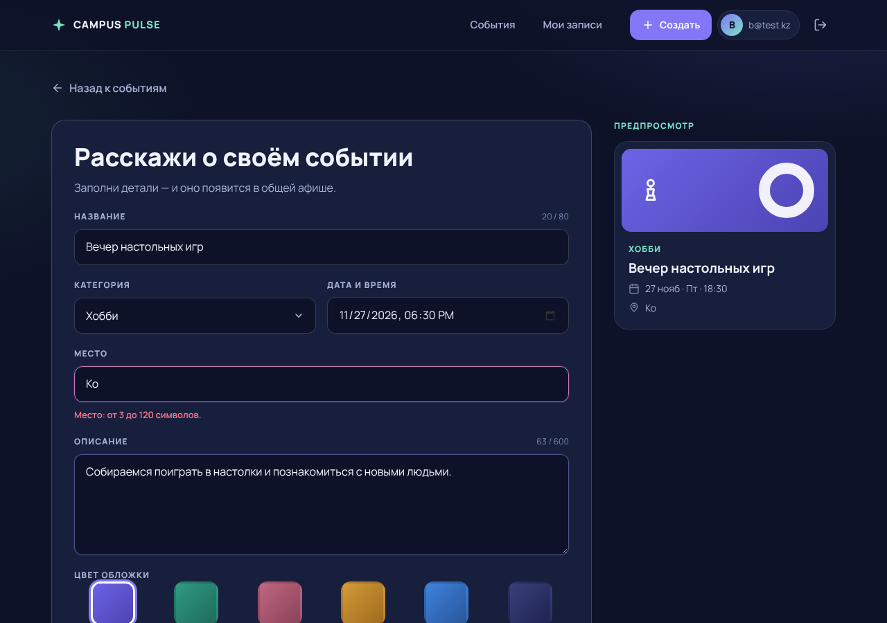
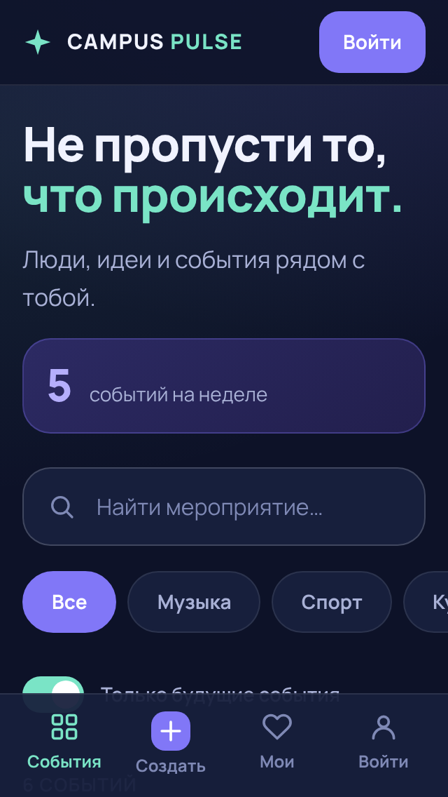

# ✦ CAMPUS PULSE

Студенческая афиша: студенты находят мероприятия университета, публикуют свои события и записываются на интересные встречи. Данные хранятся в облачной PostgreSQL (Supabase), сайт публикуется через GitHub Pages.

> **Сайт:** `https://<username>.github.io/campus-pulse-<команда>/` ← вставьте ссылку после деплоя
> **Репозиторий:** `https://github.com/<username>/campus-pulse-<команда>`

## Команда

| Участник | Роль | Зона ответственности |
|---|---|---|
| _Имя Фамилия_ (@github-A) | **A — UI/UX** | дизайн-система, главная, карточки, фильтры, форма, адаптивность, состояния loading/empty/error, деплой |
| _Имя Фамилия_ (@github-B) | **B — данные** | SQL-схема, GRANT + RLS, Supabase Auth, получение событий, запись участников, RLS-тесты |

## Цель проекта

Рабочий продукт, а не макет: общие облачные данные, регистрация, права доступа на уровне БД и прозрачная история разработки в GitHub.

## Стек

- **HTML + CSS + JavaScript** (без фреймворков), сборка **Vite**
- **Supabase**: PostgreSQL, Auth (email/password), Row Level Security
- **GitHub**: Issues, ветки `feature/*`, Pull Requests, review, Actions, Pages

## Возможности (MVP)

| № | Функция | Где в коде |
|---|---|---|
| F01 | Каталог из Supabase, сортировка по дате | `src/features/events.js`, `src/views/catalog.js` |
| F02 | Фильтр по категории, поиск по названию, «только будущие», сброс | `src/views/catalog.js` |
| F03 | Регистрация, вход, выход, статус сессии в шапке | `src/features/auth.js`, `src/ui/authModal.js` |
| F04 | Создание события с валидацией и предпросмотром | `src/views/form.js` |
| F05 | Редактирование и удаление только своих событий + экран подтверждения | `src/views/detail.js`, `src/views/form.js` |
| F06 | Запись / отмена участия, повторная запись невозможна | `src/features/members.js` |
| F07 | Loading (скелетоны), empty, error (с «Повторить»), success (уведомления), disabled-кнопки | `src/ui/components.js`, `src/ui/toast.js` |
| F08 | Адаптивность 375–1440 px: 3/2/1 колонки, нижнее меню на телефоне | `src/style.css` |
| F09 | Issues, ветки, PR, review | `.github/`, `docs/GITHUB_WORKFLOW.md` |
| F10 | GitHub Pages + реальный Supabase | `.github/workflows/deploy.yml` |

## Запуск локально

Нужен Node.js LTS (20+).

```bash
npm install
cp .env.example .env.local   # вставьте Project URL и publishable key
npm run dev                  # откройте адрес из терминала (обычно http://localhost:5173)
```

Сборка: `npm run build` → папка `dist/`.

## Настройка Supabase (один раз)

1. [supabase.com](https://supabase.com) → **New project** → дождаться запуска PostgreSQL.
2. **SQL Editor** → вставить `supabase/schema.sql` → **Run**. В Table Editor появятся `events` и `event_members` с пометкой *RLS enabled*.
3. **SQL Editor** → вставить `supabase/rls_tests.sql` → **Run**. Во вкладке результатов/Notices должны быть только `PASS` (скрипт ничего не сохраняет — в конце `rollback`).
4. **Project Settings → API Keys**: скопировать **Project URL** и **publishable key** в `.env.local`.
   ⚠️ `secret` / `service_role` key **никогда** не добавляйте в проект.
5. **Authentication → URL Configuration**: Site URL = адрес GitHub Pages, в Redirect URLs добавить его же и `http://localhost:5173`.

## Схема БД

```
auth.users ─┐
            │ creator_id                     user_id
            ▼                                   │
┌──────────────────────┐   1 : N   ┌────────────┴─────────┐
│ events               │◄──────────│ event_members        │
│ id (PK, uuid)        │ event_id  │ event_id (PK, FK)    │
│ creator_id (FK)      │  ON DELETE│ user_id  (PK, FK)    │
│ title 5–80           │  CASCADE  │ joined_at            │
│ description 15–600   │           └──────────────────────┘
│ category (6 вариантов)│
│ starts_at timestamptz│   PK (event_id, user_id) — повторная запись невозможна
│ location 3–120       │
│ cover_style          │
│ created_at           │
└──────────────────────┘
```

**Права (GRANT + RLS):**

| Кто | Может | Нельзя |
|---|---|---|
| Гость (`anon`) | читать афишу | создавать события и записи |
| Автор | создавать, менять и удалять **свои** события | менять чужие события, подменять `creator_id` |
| Участник | записываться и отменять **свою** запись | читать чужие записи, удалять чужие записи |

`creator_id` и `user_id` заполняются в БД через `default auth.uid()`; клиенту вообще не выдан GRANT на эти колонки. Количество участников отдаёт функция `event_members_count()` — только число, без персональных данных.

## Публикация на GitHub Pages

1. **Settings → Secrets and variables → Actions → Variables**: `VITE_SUPABASE_URL`, `VITE_SUPABASE_PUBLISHABLE_KEY`.
2. **Settings → Pages → Source = GitHub Actions**.
3. Слить PR в `main` → workflow *Deploy to GitHub Pages* соберёт и опубликует `dist/`.
4. Supabase → Authentication → URL Configuration — указать итоговый адрес.

## Тесты

- `supabase/rls_tests.sql` — автоматическая проверка GRANT/RLS прямо в базе (T01–T07, T10).
- `npm run test:rls` — те же атаки через настоящий API от имени двух учебных аккаунтов (см. `scripts/.env.test.example`).
- `TEST_SCENARIOS.md` — отчёт «шаги → ожидаемо → фактически» по T01–T12.

## Структура

```
campus-pulse/
  index.html
  src/main.js                 точка входа, шапка, навигация
  src/router.js               hash-роутер (#/, #/event/:id, #/new, #/edit/:id, #/my)
  src/style.css               дизайн-система Midnight Campus
  src/lib/supabaseClient.js   клиент Supabase (VITE_ переменные, тайм-аут запросов)
  src/lib/errors.js           понятные тексты ошибок (сеть, RLS, Auth)
  src/features/events.js      чтение, поиск, создание, изменение, удаление
  src/features/auth.js        вход, регистрация, выход
  src/features/members.js     запись на событие
  src/views/*.js              экраны: афиша, событие, форма, «Мои записи»
  src/ui/*.js                 карточки, модальные окна, уведомления, иконки
  supabase/schema.sql         таблицы, ограничения, индексы, GRANT, RLS
  supabase/rls_tests.sql      проверка безопасности в SQL Editor
  scripts/rls-check.mjs       проверка безопасности через API
  .github/workflows/          deploy.yml (Pages), ci.yml (сборка PR)
```

## Скриншоты

Папка `docs/screenshots/`: главная, подробности, форма, мобильная версия, работа двух пользователей.

| Главная | Событие |
|---|---|
|  |  |

| Форма | Телефон |
|---|---|
|  |  |

## Безопасность данных

В репозитории только вымышленные учебные события. Пароли, реальные персональные данные и `.env.local` в git не попадают (`.gitignore`).
